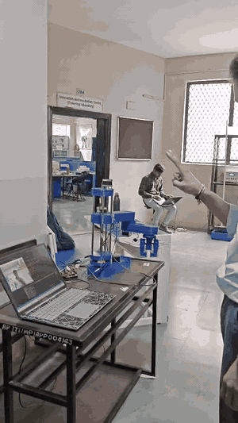
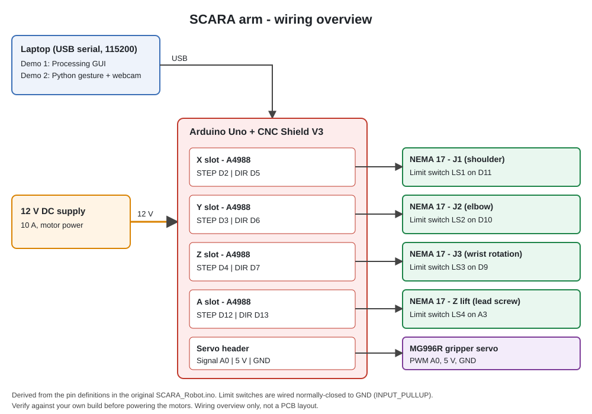
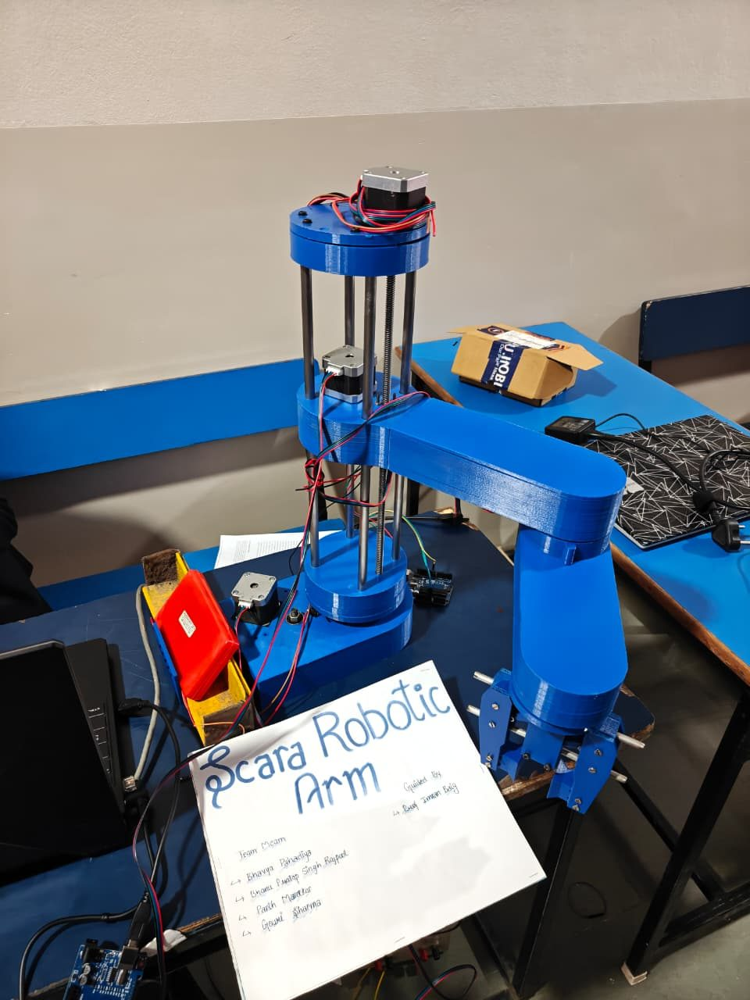
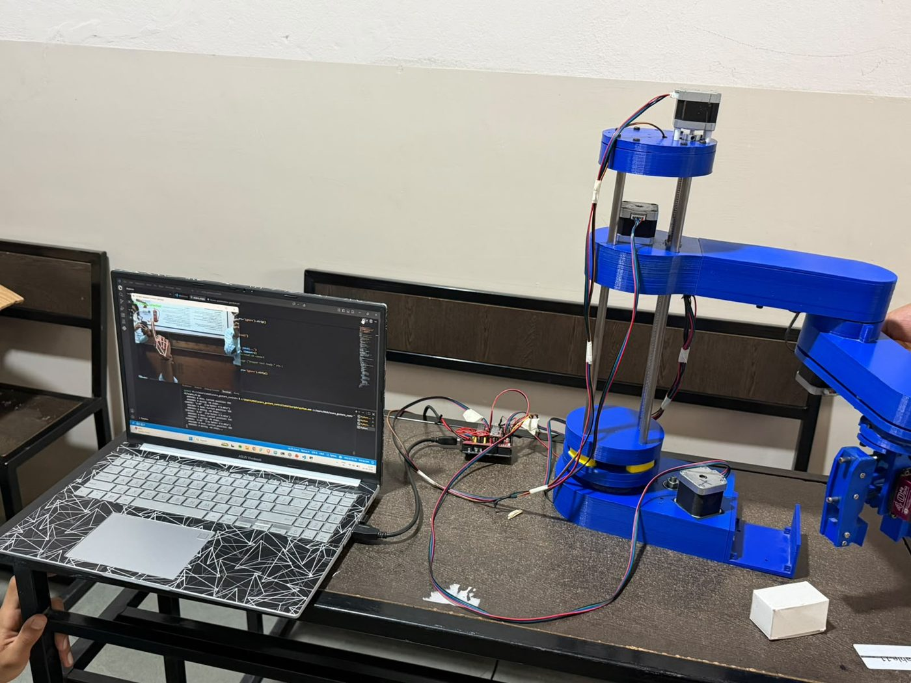
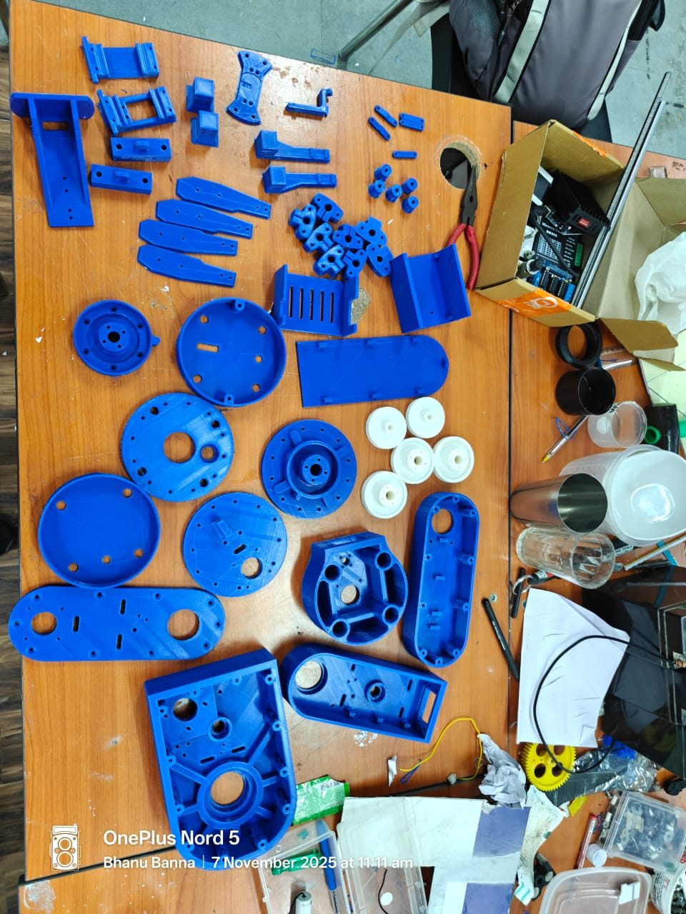
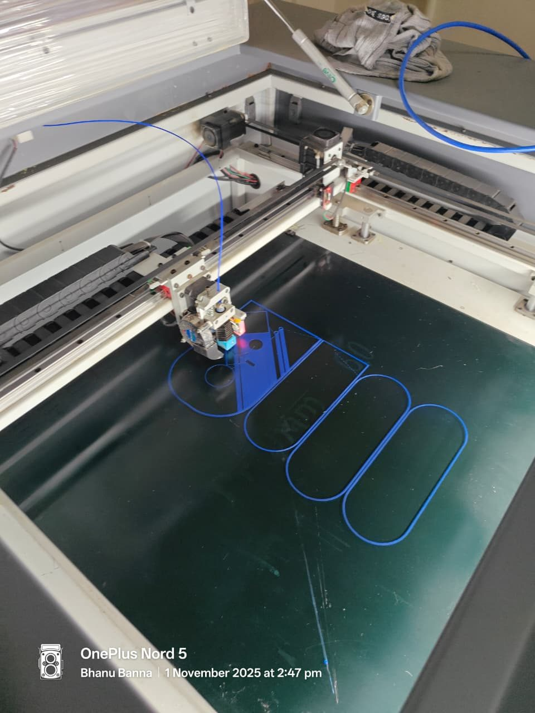
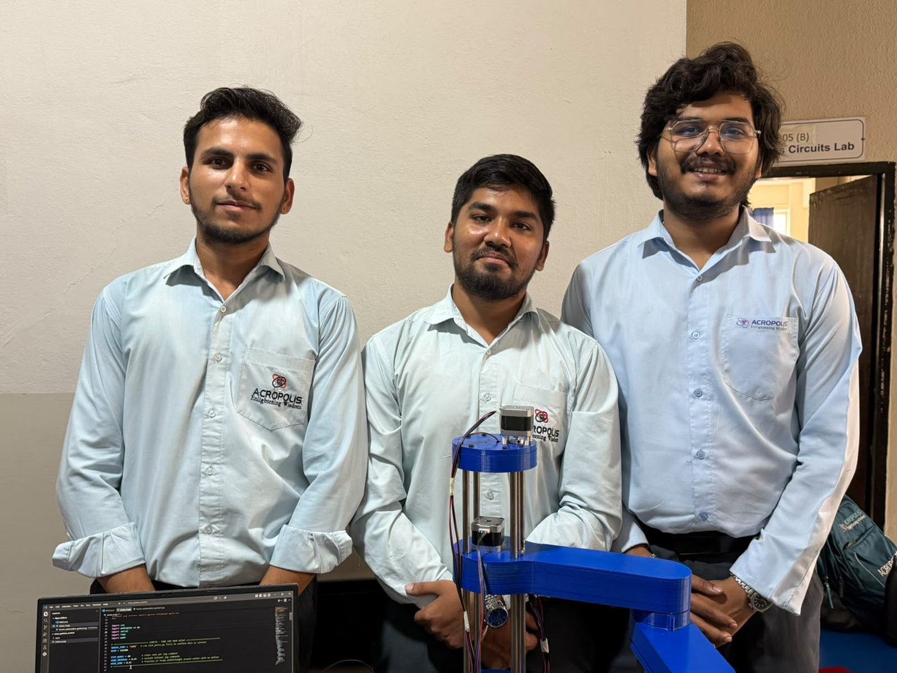
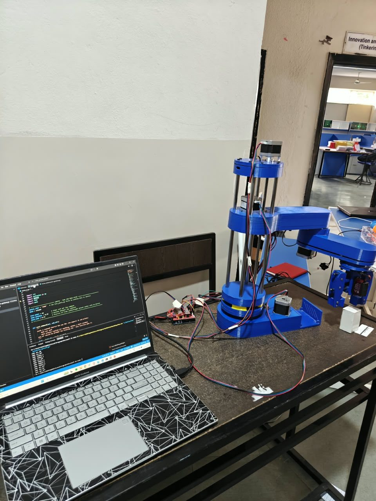

# SCARA Robotic Arm with Hand-Gesture Control

A 3D-printed, Arduino-controlled 4-DOF SCARA robot arm, built as an ECE minor project at Acropolis Institute of Technology & Research, Indore.

The mechanical design, base firmware and control GUI come from the open-source SCARA robot by Dejan Nedelkovski ([HowToMechatronics](https://howtomechatronics.com/projects/scara-robot-how-to-build-your-own-arduino-based-robot/)). Our own contribution is the hardware build and a **hand-gesture controller** written in Python with OpenCV and MediaPipe, which drives the arm from a laptop webcam.



*Gesture demo: finger and fist gestures in front of the webcam jog the arm and gripper.*

## What is ours and what is from the original design

| Part | Source |
|---|---|
| Mechanical design and STL files | HowToMechatronics (Dejan Nedelkovski). The team bought the STL files from Cults3D; they are covered by that license and are not included here |
| Base firmware `SCARA_Robot.ino` and Processing GUI | HowToMechatronics. Not redistributed here |
| Printing, assembly, wiring and bring-up of the arm | This team |
| **Hand-gesture control (`software/gesture_control/scaracv.py`)** | **This team, original work** |
| Wiring diagram, pin map and BOM in this repo | Written for this repo from the original firmware's pin definitions |
| Reference gesture firmware (`firmware/gesture_serial_controller`) | Written for this repo, not verified on hardware |

## Two ways we controlled the arm

### Demo 1: GUI control (team of 4)
The Processing GUI from the original project, used as published. It has sliders and jog buttons for each joint (forward kinematics), X/Y/Z entry with a **Move to position** button (inverse kinematics), a gripper slider, and **Save position / Run program** for pick-and-place sequences.

### Demo 2: Hand-gesture control (team of 3)
A laptop webcam tracks one hand with MediaPipe. The script works out which fingers are extended, picks an axis or the gripper, and sends a short text command over USB serial (115200 baud) to the Arduino.

| Gesture | Action | Command sent |
|---|---|---|
| Index finger only, left / right of frame centre | X-slot stepper, jog in either direction | `X40` / `X-40` |
| Index + middle finger, left / right of centre | A-slot stepper, jog in either direction | `A40` / `A-40` |
| Any other finger combination, hand above / below centre | Z-slot stepper, jog up / down | `Z40` / `Z-40` |
| Fist | Gripper open | `G1` |
| Open palm | Gripper close | `G0` |

Jog commands are 40 steps each, sent at most every 0.15 s, with a dead zone around the frame centre so a resting hand does not move the arm. The script prints every command it sends and every reply from the Arduino, which makes serial problems easy to debug.

## Hardware

Arduino Uno + CNC Shield V3, four A4988 drivers, four NEMA 17 steppers, an MG996R servo gripper, four limit switches, and a 12 V DC supply. Control is open-loop (no encoders); limit switches are used for homing in the original firmware.



- [Pin map](hardware/pin-map.md)
- [Bill of materials](hardware/bom.md)

## Getting started

1. Print and assemble the arm following the [original tutorial](https://howtomechatronics.com/projects/scara-robot-how-to-build-your-own-arduino-based-robot/) ([video](https://youtu.be/1QHJksTrk8s)).
2. Wire it as in [`hardware/pin-map.md`](hardware/pin-map.md). Keep power off while wiring.
3. Install the **AccelStepper** library in the Arduino IDE.
4. **Demo 1:** download `SCARA_Robot.ino` and the Processing GUI from the tutorial page.
5. **Demo 2:**
   ```bash
   # flash firmware/gesture_serial_controller/gesture_serial_controller.ino from the Arduino IDE, then:
   cd software/gesture_control
   pip install -r requirements.txt
   python list_ports.py        # find your Arduino's port
   # set SERIAL_PORT near the top of scaracv.py (default is COM8)
   python scaracv.py           # press ESC in the video window to quit
   ```

The reference gesture firmware does not home the arm. Power it on with the arm in a known, safe pose and keep the workspace clear.

## Project status

| Item | Status |
|---|---|
| Arm built and demonstrated, presented at NLPC-26 | Done |
| GUI demo | Demonstrated |
| Gesture demo | Demonstrated with the team's original test firmware |
| `gesture_serial_controller.ino` in this repo | Reference sketch, **not yet verified on the arm** |
| Wiring diagram | Derived from code pins, check against your build |
| Positioning accuracy | Not measured in this repo |

## Gallery

| | |
|---|---|
|  |  |
| *Assembled arm* | *Gesture-control setup: laptop, Arduino and arm* |
|  |  |
| *Our 3D-printed parts* | *Laser-cutting session during fabrication* |
|  |  |
| *The team with the arm* | *Arduino + CNC Shield wired to the arm* |
|  | |
| *Gesture control running: webcam preview and serial log on the laptop* | |

## Ideas for next steps

- Camera-based object detection to pick and place objects automatically
- Feedback sensors (encoders) for closed-loop control
- ROS integration for planning and simulation
- Stronger materials for the links to improve rigidity and payload
- Smoother gesture control, for example mapping hand position to arm position instead of jogging

## Team

Bhanu Pratap Singh Rajpoot, Bhavya Pahadiya, Parth Marotkar and Gouri Sharma (GUI demo); Bhanu Pratap Singh Rajpoot, Bhavya Pahadiya and Parth Marotkar (gesture demo).
Department of ECE, Acropolis Institute of Technology & Research, Indore. Guided by Mr. Imran Baig.

## Credits

- SCARA robot design, firmware and GUI: Dejan Nedelkovski, [HowToMechatronics.com](https://howtomechatronics.com/projects/scara-robot-how-to-build-your-own-arduino-based-robot/). See [`docs/ATTRIBUTION.md`](docs/ATTRIBUTION.md).
- [AccelStepper](http://www.airspayce.com/mikem/arduino/AccelStepper/) library by Mike McCauley
- [MediaPipe](https://developers.google.com/mediapipe), [OpenCV](https://opencv.org/) and [pySerial](https://pyserial.readthedocs.io/)

## License

Original files in this repository (gesture script, reference firmware, diagrams and documentation) are under the [MIT License](LICENSE). Third-party designs, code and models referenced above remain under their own terms; please get them from the original source.
